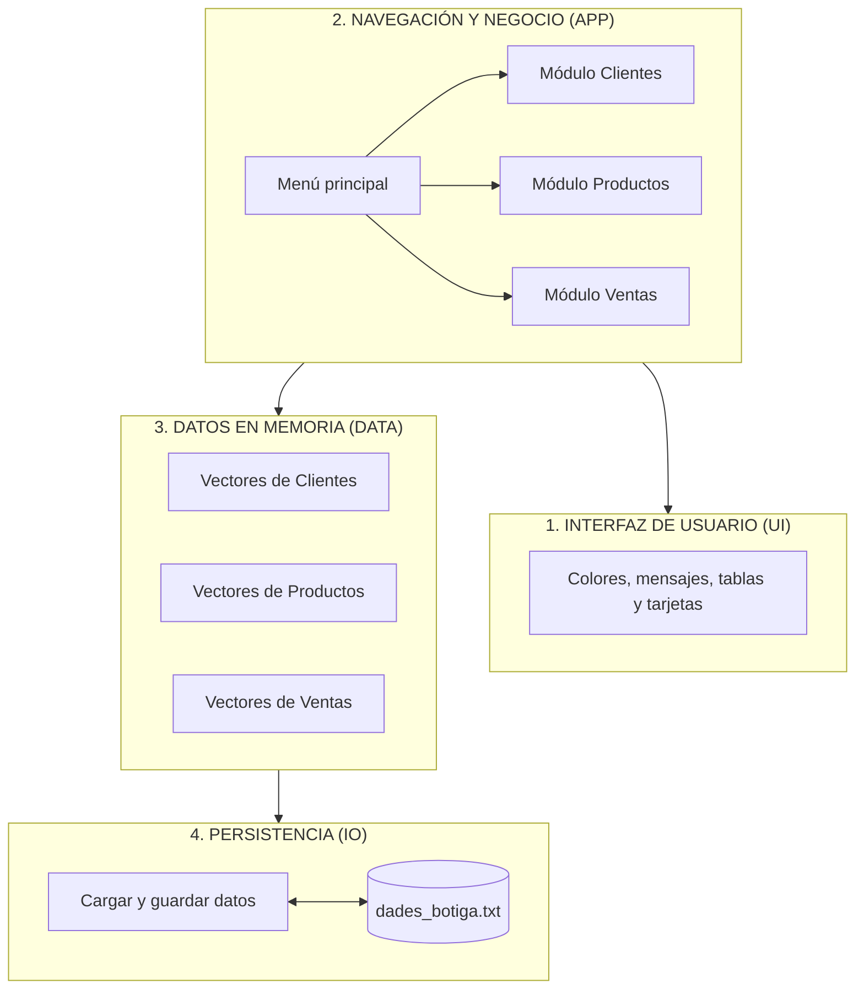
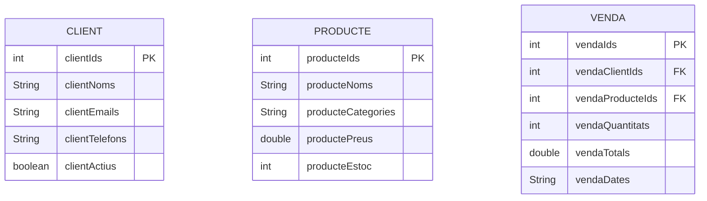

# Diagramas de Arquitectura y Modelo de Datos

## 1. Arquitectura de Main.java

## 2. Modelo Entidad-Relación

## 3. Descripción

- UI: interfaz de terminal y presentación de información.
- APP: navegación y módulos de clientes, productos y ventas.
- DATA: almacenamiento mediante vectores paralelos.
- IO: inicialización y persistencia en archivos.

Los módulos y la persistencia están pendientes de implementación en las etapas posteriores.
